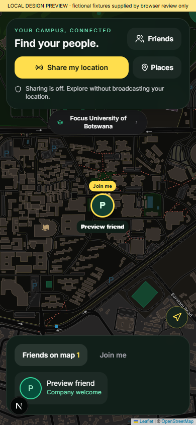
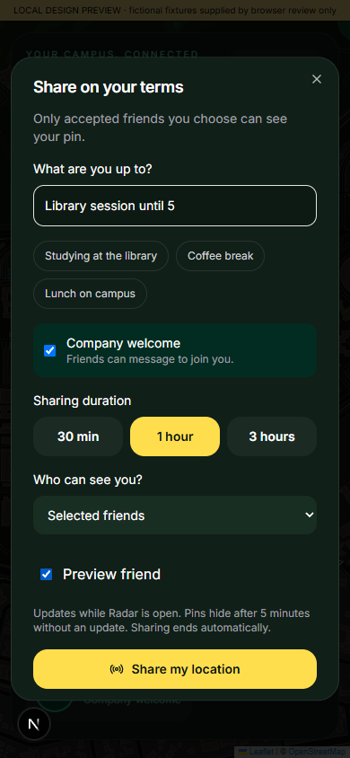

# Social Radar implementation

Current: peer pins disabled, old location table owner-only; map shows hazards, SOS and promoted places.
Target: map-first Radar, accepted friends, explicit timed sharing (30/60/180 minutes), all/selected friends, temporary status and company-welcome invitation, direct messaging, stop/revoke/block, fresh timestamps.

Branch: feature/social-radar. Existing SOS remains separate. No payments or production publishing.

Backend: new isolated tables behind authenticated RPCs; raw location access revoked, server timestamps and bounded expiry, verified-member checks, bidirectional blocks and accepted relationships on every read. Polling reauthorizes access every 15 seconds; local expiry/staleness filter every second. No location history. Coordinates leave only through explicit share. Browser foreground tracking only; stale positions disappear after five minutes. Unmount stops watcher, share expires unless stopped earlier. Location viewers may retain data already seen; revocation stops future server reads.

Acceptance: no automatic geolocation on entry; friends-only pin access; selected audience enforced; expired/stale/revoked/blocked data excluded; unrelated callers cannot accept friendship; permission-denied state recoverable; existing messaging/SOS retained. Focused isolated Postgres authorization tests, types/lint/build and mobile visual checks.

Release: review branch, apply migration after backup, then deploy app. Existing location table is not widened. Rollback app to previous commit; revoke authenticated execution on radar RPCs to disable new sharing, retain tables until safe removal. No production schema changes are part of this local implementation.

## Release gates and evidence

- Live read-only metadata inspection confirmed profiles, user_blocks and is_kampus_member exist; new Radar tables do not exist. pg_cron is not currently enabled. Enable Supabase Cron before applying the migration so its named every-minute expiry-deletion job is installed. Verify the job runs before enabling sharing in production. Read authorization expires independently of that cleanup job.
- Focused isolated Postgres tests execute the new migration against a synthetic prerequisite schema: `node tests/radar.database.mjs`. Ten privacy/authorization scenarios passed. No real accounts or production content were created.
- Existing app tests: 73 passed. Types passed. Lint: no errors; existing warnings in KampusKritic and ProfileReviews.
- Browser review uses intercepted RPC fixtures exclusively on the development-only `/radar-preview` route. It covers opt-in geolocation, selected-friend sharing, stopping, chat affordance, Escape dismissal, permission denial and 320/390/1280 viewports. No real multi-account production session has been tested.
- The older all-migration database fixture cannot initialise because `20261109145000_community_identity_and_opt_in_push.sql` expects a notifications table absent from that fixture. That pre-existing test-fixture gap was not changed. The new migration's isolated tests pass; do not equate them with full deployed-schema testing.
- Leaflet now mounts through a cleanup-safe native lifecycle instead of React-Leaflet MapContainer, which failed browser initialisation in this checkout. Existing place-focus links and marker click callbacks remain.
- Foreground location heartbeat every 30 seconds; writes throttled; watchers and timers cleaned up. Server writes do not extend expiry. GPS updates stop when Radar is closed; its last pin becomes stale within five minutes and its chosen sharing window still expires. Stop sharing deletes the row immediately.

## Review images

All displayed people are explicitly labelled local design fixtures.

Promo brief: [RADAR-PROMO-ANTIGRAVITY.md](RADAR-PROMO-ANTIGRAVITY.md). It distinguishes implemented local behaviour from launch availability and uses the current initials pins and chat-based invitation flow.

- Final production build: PASS. Browser fixture review and permission-denied recovery: PASS. New Radar lint errors/warnings: none. Production account-to-account acceptance: NOT TESTED; feature NOT DEPLOYED.

